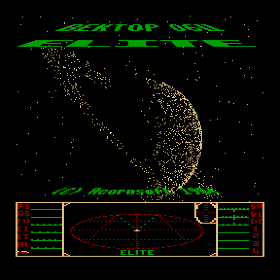
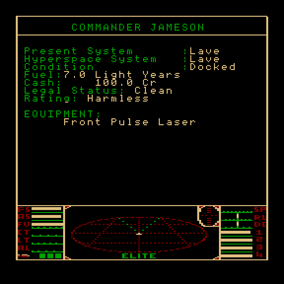
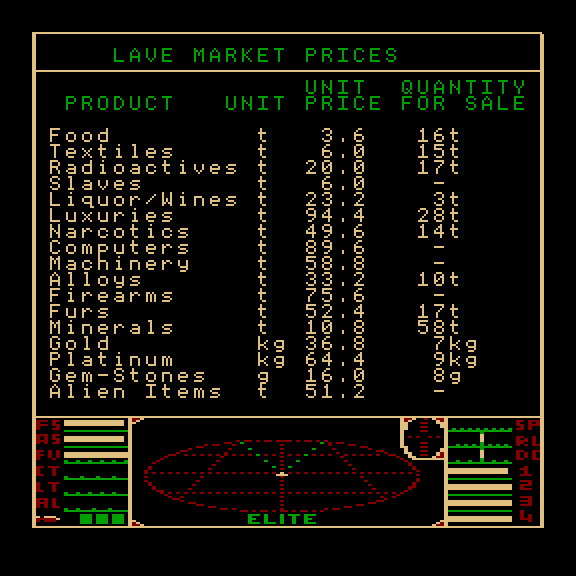
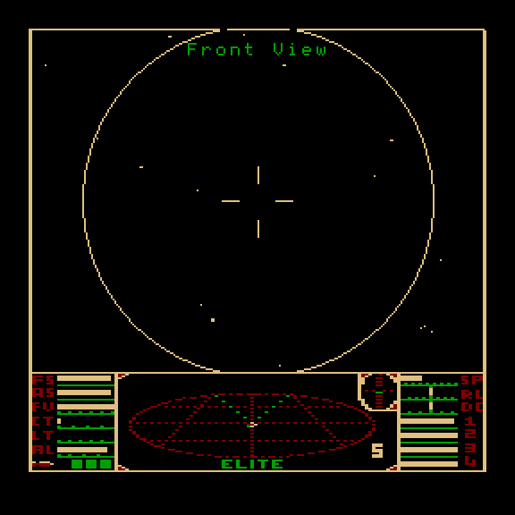
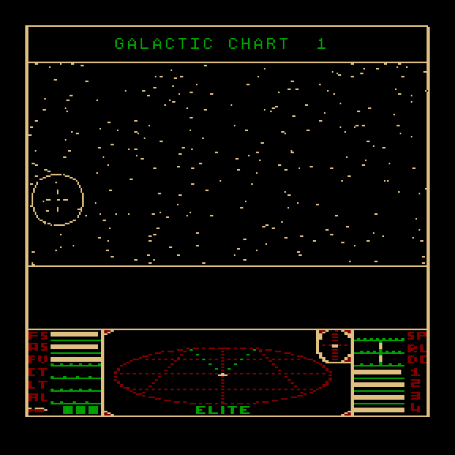
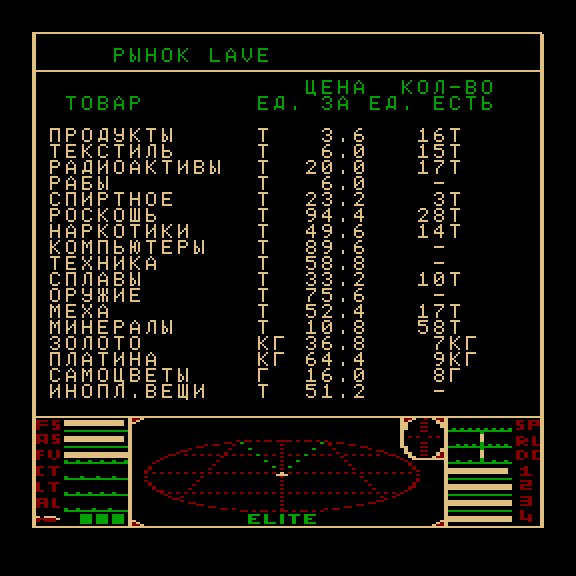
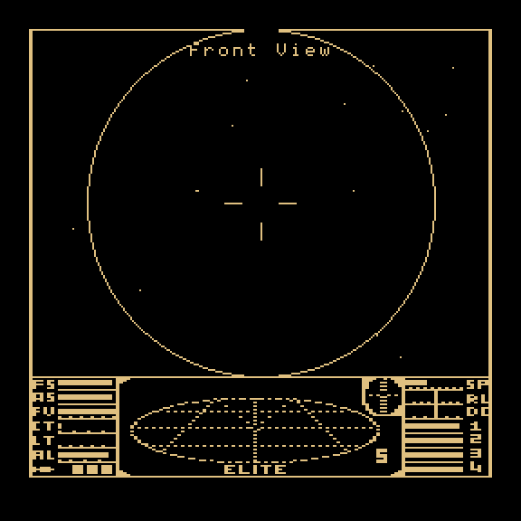
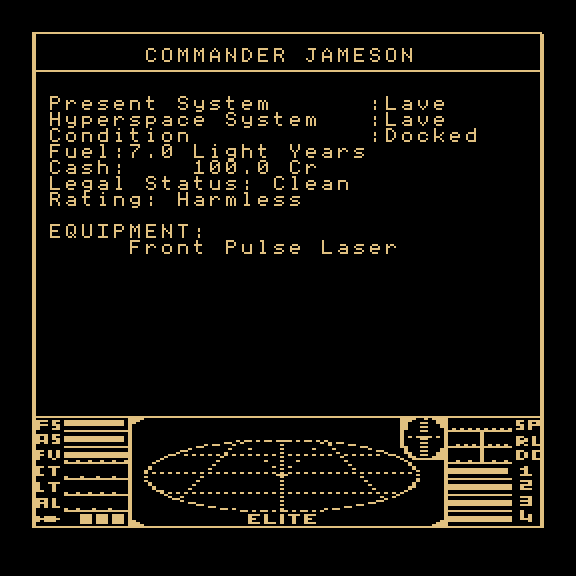

# Elite для Вектора-06Ц

Порт **Elite** (Acornsoft, 1984; Ян Белл и Дэвид Брабен) на ванильный **Вектор-06Ц**: i8080 3 МГц, 48 КБ под
программу и две плоскости экрана, звук на ВИ53, без квазидиска и без AY. Основа — кассетная версия для BBC Micro:
она перенесена на i8080 и сверена с настоящим кодом BBC, исполняемым под Node (образ стенда совпадает с BBC на семи
сценариях игры). Сверху — добавки дисковой BBC (описания планет, все корабли, автопилот стыковки, ангар, две
миссии), правила и три миссии версии для ZX Spectrum 48K, тексты Elite Legend (ZX 128) и своё: заставка с Сатурном
и мелодией, управление под русскую клавиатуру Вектора, джойстик «П», русский перевод.

Подробное описание версии и сравнение с ZX Spectrum — [docs/ABOUT.md](docs/ABOUT.md); управление —
[docs/CONTROLS.md](docs/CONTROLS.md); план и решения — [docs/PORT_PLAN.md](docs/PORT_PLAN.md); хроника —
[docs/JOURNAL.md](docs/JOURNAL.md).

> **Права.** Код Elite © Acornsoft / Ян Белл и Дэвид Брабен; разбор исходников BBC с комментариями © Mark Moxon
> (github.com/markmoxon, без лицензии). Репозиторий закрытый; открытая публикация образов — только после решения
> вопроса прав. Исходники оригиналов (`orig/`) в git не входят.

| Заставка | Статус командира | Рынок |
|---|---|---|
|  |  |  |

| Полёт | Галактическая карта | Рынок (русская сборка) |
|---|---|---|
|  |  |  |

| Чёрно-белая: полёт | Чёрно-белая: статус |
|---|---|
|  |  |

## Готовые образы

Все грузятся с 0100h, короче 64 КБ (заставка с Сатурном внутри образа, после показа её область обнуляется), поэтому
годятся и для Вектора Турбо+ из CP/M (`ELITE -V T3`).

| Файл | Что это |
|---|---|
| [`rom/elite.rom`](rom/elite.rom) | цветная, английский текст (язык оригинала) |
| [`rom/elite-ru.rom`](rom/elite-ru.rom) | цветная, русский текст (всё прописными, названия планет латиницей) |
| [`rom/elite-merid.rom`](rom/elite-merid.rom) | цветная, планета с меридианами и кратером, как на BBC (в основной — простая окружность, как на ZX) |
| [`rom/elite-bw.rom`](rom/elite-bw.rom) | чёрно-белая с двойным буфером, английский текст |
| [`rom/elite-bw-ru.rom`](rom/elite-bw-ru.rom) | чёрно-белая, русский текст |

**Цветная и чёрно-белая.** В цветной обзор раскрашен через вторую плоскость: солнце, луч лазера и облака взрывов
красные, панель в четыре цвета. Вторая плоскость в чёрно-белой занята под второй буфер: обзор рисуется в скрытую
плоскость, а палитра показывает готовый кадр — картинка не мерцает (планета видна ровно в каждом кадре, рёбра
кораблей не гасят друг друга), но весь экран одного цвета. Чёрно-белая живёт в ветке `dbuf` (сборка `-DDBUF`) и
собирается из неё той же командой.

На MiSTer (ядро Vector-06C) — положить образ в `games/VECTOR06/`; в Emu80 — `Emu80qt --platform vector --run
rom/elite-ru.rom`.

## Управление

Полёт — под русскую клавиатуру Вектора, по первой букве действия (таблицы — `tools/convert/keys.py`):

| действие | клавиша Вектора |
|---|---|
| крен / тангаж | стрелки |
| огонь | Пробел |
| разгон / тормоз | Я / ТАБ |
| ракета: цель / пуск / снять | Ц / Р / С |
| ЕСМ, бомба, капсула | Е, Б, К |
| автопилот стыковки: включить / отключить | А / О |
| прыжок к планете, гиперпрыжок, галактический | П, Г, УС + Г |
| маскировка (после миссии) | М |
| виды вперёд, назад, влево, вправо | F1–F4 |
| пауза | СТР |

Экраны: F1–F5 — функциональные клавиши BBC f0–f4 (в доке: вылет, купить, продать, оборудование, галактическая
карта), СС + F1–F5 — f5–f9 (ближняя карта, данные о системе, цены, статус, груз). На паузе, картах и при вводе
имени — раскладка BBC. Сохранение командира — на магнитофон.

**Джойстик — только «П»** (разъём ПУ, порт 06h, оба устройства). В полёте: крен и тангаж, огонь — лазер, вторая
кнопка — разгон; на экранах — стрелки, пробел и ВК. Нажатое считается по отличию от состояния покоя, снятого при
запуске, так что полярность не важна. Порт 0Eh не читается: на Векторе Турбо+ там мусор.

**Отладочные клавиши (на паузе СТР):** M — выдать очередную миссию версии ZX при следующем прибытии; K — добавить
256 побед (условие миссий дисковой версии) и отметку «Сверхновая выдавалась». Проверяются тестом `mischain.mjs`.

## Состояние

Сделана вся кассетная BBC (полёт, бой, торговля, карты, гиперпрыжки, сохранение) и большая часть дисковой; пять
миссий; счёт и ранги — как на ZX 48K. Чего нет и почему — `docs/research/bbc_features.md` и раздел «Открытые
вопросы» в `docs/prompts/NEXT-SESSION.md`. Игра занимает почти всю память: в основной сборке свободно около 280 байт.

## Сборка

Нужны: Node.js (проверено на 26.4), Python 3 (3.14), POSIX-оболочка, git. Ассемблер sjasmplus 1.24.0 лежит в
`tools/bin/` (сборка для macOS arm64); на другой системе — свой sjasmplus 1.24 через переменную `SJASMPLUS`.

```sh
git clone git@github.com:reqw41/elite-v06c.git
cd elite-v06c
sh tools/build_roms.sh          # все пять образов -> rom/
```

Отдельные сборки: `sh v06c/build.sh [-DRUS] [-DMERID] [-DSCHED]` → `v06c/build/elite*.rom` (ключи — в шапке
`v06c/build.sh`); чёрно-белая — `sh v06c/build.sh -DDBUF` в ветке `dbuf` → `elite_db.rom`. Сборка воспроизводима:
из чистого клона получаются побайтно те же образы.

## Проверки

Тесты гоняют образ в эмуляторе [vector06js](https://github.com/svofski/vector06js) (путь — `VECTOR06JS`, по
умолчанию `~/projects/vector06js`) и сверяют его с кодом BBC, исполняемым под Node. Для сверки нужны исходники
BBC в `orig/bbc/` (разборы Марка Моксона, github.com/markmoxon; в git не входят).
Полный прогон (около 25 минут) — в конце [docs/NEXT_SESSION.md](docs/NEXT_SESSION.md):

```sh
sh v06c/build.sh && sh v06c/build.sh -DSCHED && sh v06c/build.sh -DRUS
for s in equip save launch trade fight jump voyage; do node v06c/test/t27.mjs $s | grep "T27\|FAIL"; done
node v06c/test/joy.mjs                       # джойстик «П»; JOY_INJECT=1 — порт молчит, тест обязан покраснеть
```

## Каталоги

| путь | что |
|---|---|
| `orig/bbc/` | исходники BBC Elite: кассета, диск, 6502SP (в git не входят; github.com/markmoxon) |
| `orig/EliteLegend_v1_09_source/` | исходники Elite Legend (в git не входят) |
| `docs/research/` | сравнение версий, архив плана по Legend |
| `tools/bin/` | sjasmplus 1.24, salvador |
| `tools/zx/build_orig.sh` | сборка оригинала на Маке → `work/zxbuild/!bin/` |
| `tools/analysis/` | размеры по файлам (`lst_sizes.py`), черновой бюджет (`budget.py`) |
| `work/` | временное, в git не входит |

## Сборка Elite Legend (донор)

```sh
sh tools/zx/build_orig.sh
python3 -I tools/analysis/budget.py work/lst_sizes.txt 1.30
```
